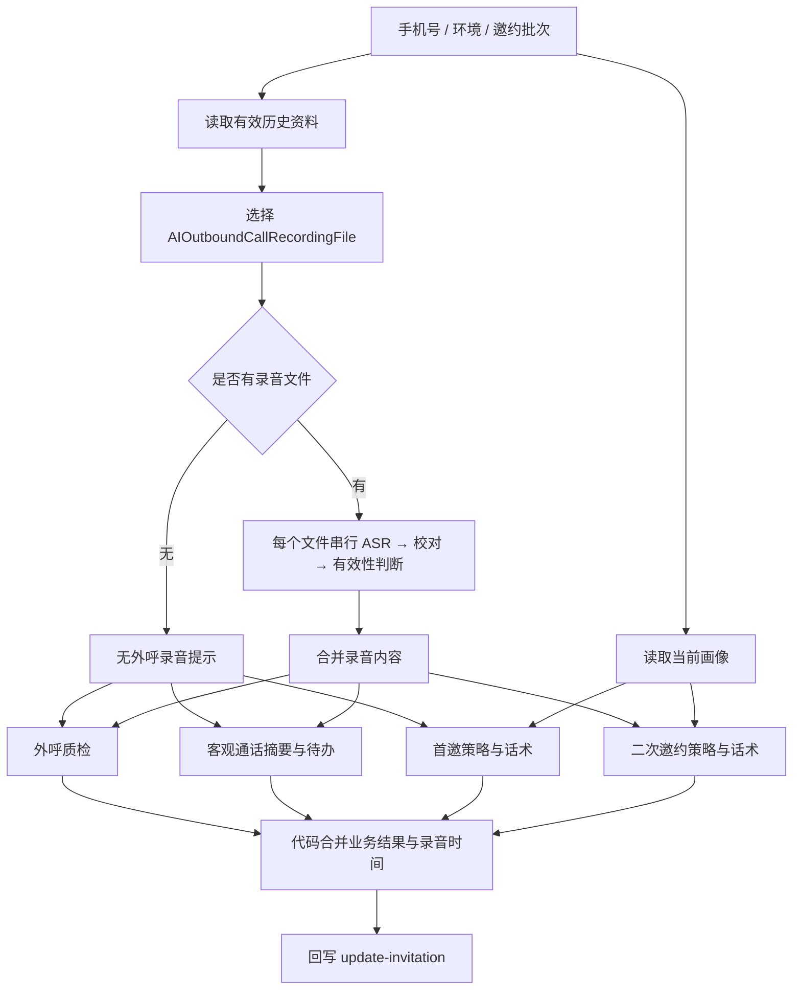
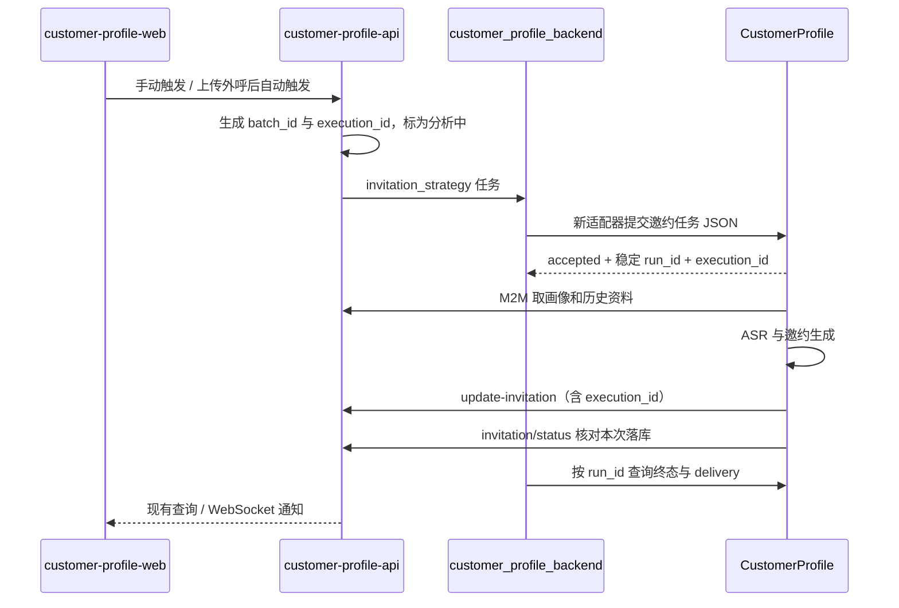

# 邀约工作流高代码迁移

基于 2026-10-29 提供的四份 Dify DSL，分支为 `codex/invitation-workflow`，起点为
CustomerProfile `dev` 的 `8b8fc14`。本轮已完成可运行的邀约工作流、接单与状态查询，
验证范围为离线模拟服务；线上任务路由尚未切换。

## 1. 四份文件的真实职责

原始文件含接口鉴权信息，不直接入库；文件与提示词的来源指纹见
[来源清单](../reference/invitation-workflow-sources.json)。运行期只依赖 Python 和已提取的模板，
不读取 Downloads，也不解释执行 YAML 中的代码。

| 文件 | 规模 | 职责 |
|---|---|---|
| 客户线索邀约 | 24 节点 / 30 边 | 主入口；读取画像、录音，生成质检、话术、待办，最后回写 |
| 外呼录音原始数据解析 | 19 节点 / 20 边 | 按环境读取有效历史资料，选择外呼渠道，逐个文件提取并合并 |
| 录音文件内容抽取（纯识别，无加工） | 12 节点 / 11 边 | ASR 提交、查询、识别结果提取、模型校对、有效性判断 |
| Gemini（异常输出重试版） | 11 节点 / 10 边 | 单次生成加最多两次异常重试，被主流程三处生成任务复用 |



### 主流程

入口接收 `phone_number / work_env / batch_id`。按环境并行读取完整画像与历史录音。
外呼原始数据解析只消费 `AIOutboundCallRecordingFile` 渠道，携带记录的 `updated_at`。
多个文件在 Dify 中是串行识别，`parallel_nums=10` 并未生效，因为 `is_parallel=false`。

ASR 子流程名称容易误导：它并非真正的纯识别。识别后还会调用模型校对，再调用模型判断
是否有效。无效时把正文替换为“该录音文件无有效内容”。此次迁移保留这两步，独立于
画像管线当前采用的零 LLM 纯识别变体，避免改变画像管线的既有行为。

录音准备好后分三路：

1. 外呼质检：根据考核标准评价流程执行、沟通表达、专业知识、邀约引导。每维 0–100 分，
   细项固定为 3 / 3 / 2 / 3 项；总分为四维平均值四舍五入，等级按 90 / 80 / 70 / 60 分段。
   客户忙碌、要求微信、要求晚点联系属于有效短通话，不能机械按完整通话扣分。
2. 通话摘要与待办：只能从通话中抽取客观内容，不能从画像生成待办；无事项返回空数组。
3. 策略与话术：完全无录音时使用首邀提示词；有录音时使用二邀提示词，客户在通话中明确
   表达的渠道、时间和拒绝意愿优先于画像推断。**存在文件但被判无效，仍走二邀分支**，
   由二邀提示词按无有效通话处理；这与原导出的分支语义一致。

最后用代码合并结果，`recording_label` 使用录音记录时间，`generated_at` 使用结果生成时间。
回写体直接包含 `script / audit / follow_up_items / follow_up_summary`，没有画像回写使用的
`analysis_result` 外壳。工作流输出 `result` 是这份回写体的 JSON 字符串。

### 异常重试子流程

名称叫 Gemini，但本次导出实际使用 `qwen3.8-flash`。它检测 usage 全零、文本为空、
未闭合的 `<think>`、疑似只输出思考内容，最多调用三次；`output_json` 输入没有参与判断。
第三次输出直接返回，没有最终校验。因此原流程即使三次仍异常，也可能进入合并节点。

## 2. 实现选择与差异

复用 CustomerProfile 的持久化队列、worker、定义快照、子运行、请求尝试、限流、ASR 云适配
和运行台。业务逻辑为普通 Python 函数，工作流定义只表达依赖与留痕边界。没有再引入一套
任务框架，也不在运行期重放 Dify 节点图。

主要实现：

- `src/customer_profile/workflows/invitation.py`：取数、首邀/二邀分支、三路生成、合并、回写核对。
- `src/customer_profile/workflows/invitation_audio.py`：逐文件识别，保留此次导出的校对及有效性判断。
- `src/customer_profile/invitation_contract.py`：输入、话术、质检、待办的结构校验和确定性评分。
- `src/customer_profile/invitation_inbound.py`：沿用接单进程的鉴权，持久化入队和按执行标识去重。

这里保留了七份提示词的原始文本与换行。ASR 两份提示词用独立资源，未修改既有画像模板。
没有逐节点复制重试子流程；它收敛到现有 `LlmClient`，仍是首次加两次重试，共用限流和留痕。

| 原导出的问题 | 当前实现的处理 |
|---|---|
| 主流程环境判断用相等，录音子流程用 contains，非标准输入可能取错环境 | 环境仅允许 `test / production`，取数、回写与凭据始终一起选择 |
| 任取第一条外呼资料，而接口按时间升序返回 | 优先匹配业务 `batch_id` 或 `raw_payload.manual_outbound_call_id`；同批次取最大记录 id |
| 有批次资料却找不到目标批次 | 明确失败，避免拿别次通话生成本次邀约；仅无批次元数据的旧记录降级选最新 |
| `media_urls=[]` 被序列化为非空文本，可能错误进入多文件支路 | 单 URL、JSON 数组、空数组统一处理；多文件保持原顺序，去重同一 URL |
| 历史资料解析失败被当作没有录音 | 取数或形状错误使运行失败，不生成“无数据”的成功结果 |
| JSON 错误被合并节点吞成空字典，再成功回写 | JSON 与业务形状都在三次尝试预算内校验，失败阻断回写；不抢救截断 JSON |
| 模型自己算分或给错等级 | Python 根据四维有效整数分数计算总分与等级，采用普通四舍五入 |
| 缺失录音时间时填当前时间 | 保留未知，不虚构上传时间；有时区的时间转为上海时间展示 |
| 没有 execution_id | 新接单接口必填，原样透传至成功回写；内部 `/runs` 保留旧系统无 token 的兼容路径 |
| 接单重试可能重复生成、把在飞运行重新入队 | 手机号、批次、execution_id 生成稳定 run_id；数据库首次插入，重复返回同一次运行 |
| HTTP 200 不等于本次邀约已被写入 | 回写后读业务状态，核对手机号、批次、execution_id、完成状态、话术和质检是否均存在 |
| 回写超时后盲目重发可能重复归档 | 回写只尝试一次；超时、状态不匹配交给任务后端核对，不自动整条重跑 |

当前模型通过 `LLM_BASE_URL / LLM_API_KEY / LLM_MODEL` 接入兼容服务，temperature 沿用本仓库
统一的 0.5。原导出主生成是 1、录音校对/有效性判断是 0.4，因此迁移后的输出不应宣称与
Dify 逐字等价；相同样本的业务质量对照仍需真实模型验证。

### 提示词本身需要业务确认的事项

首邀提示词明确面向**广汽埃安、约 10–15 万元**，二邀提示词为泛汽车场景，ASR 校对与待办示例
仍出现猛士。此次保留原文以便对照；如果实际业务是猛士，首邀品牌口径必须先统一再上线。
有效性判断提示词的 JSON 示例还包含大写 `True`、注释和双大括号，实际并非合法 JSON；本轮
通过输出校验拦截，示例文本修订应作为单独的提示词变更。

## 3. 与现有仓库的适配

以下是本地检出的代码观察，不代表已核验线上部署版本。尤其任务后端当前为 detached HEAD
`52546c1`，本地还存在其他 worktree，联调时应核对实际镜像对应提交。



| 仓库 | 现状及本轮适配边界 |
|---|---|
| CustomerProfile | 本轮新增邀约能力，已有画像入口继续工作；工作流统一注册，运行台可查看子运行与请求尝试 |
| customer-profile-api | 已有完整邀约存储、历史归档、成功/失败回调、执行身份校验和状态核对接口；沿用它作为业务数据唯一来源 |
| customer_profile_backend | 仍负责业务任务队列、领取、重试与失败通知；当前检出支持 Dify、擎天、ontology，尚无 CustomerProfile 邀约适配器 |
| customer-profile-web | `InvitationTab.jsx` 与 `invitationApi.js` 消费现有 script/audit/待办结构；成功结果保持该契约，无需改展示页面 |
| customer-profile-backend-runner | 环境中声明过此路径，但本地目录不存在；本轮未据此假设已有可用适配器 |

### 任务后端需要完成的切换

建议先按任务类型或专用 worker 路由 `invitation_strategy`，画像任务继续沿原配置执行。
不能只把全局 `WORKFLOW_PLATFORM` 切换后让两类任务都走新服务，也不能把只支持画像的
ontology 客户端用于邀约。

适配器可参考现有 `src/infrastructure/ontology/client.py` 的持久化 submit/poll 模式，
但要使用本服务的独立邀约契约，不能沿用画像输出解析器：

1. 将 `customer_phonenumber` 映射成 `phone_number`，透传 `batch_id / work_env / execution_id`。
   当前业务 API 已支持执行标识，但所检出的任务后端入参及客户端协议还没有该字段，需打通
   API、领域记录、数据库、提交回执与工作流客户端，不能在中途丢失。
2. 通过 `X-API-Key` 调本服务新的邀约接单接口，把返回的 `run_id` 持久化为远程运行标识。
   提交超时可用同一业务身份再次查询/提交，不能创建新的 execution_id 来猜测重试。
3. worker 恢复后继续查同一 run_id，不重新触发完整生成。重跑一项已经终结的业务任务时由
   业务 API 创建新的 execution_id，同一录音批次可以对应多次不同的执行。
4. 同时检查执行状态与 `delivery`：`confirmed` 才表示业务结果已核对落库；`skipped` 为影子
   运行；`unknown` 表示回写可能发生，需要向业务 API 查同一执行；`not_attempted` 表示本次
   尚未尝试成功回写。不能只看到运行成功或 callback HTTP 200 就将业务队列标成功。
5. 明确失败且重试策略耗尽后，由任务后端调用已有 `invitation-failed`，携带同一个
   execution_id 和 `final=true`。`unknown`、中断或超时须先核对，不直接覆盖可能已落库的成功。

**本轮没有修改其他仓库、替换线上路由或发送真实业务回写。** 上述任务后端适配尚未实施，
因此当前分支可独立提交和验证，尚不能把现有业务流量直接切过来。

## 4. 接单与验证

邀约接口复用 `customer_profile.inbound`（默认 8099），沿用独立的 `INBOUND_API_KEY`；
接单进程只写队列，执行由同库 worker 负责。原有画像 `POST /api/v1/tasks` 契约保持不变。

新邀约请求为 JSON，示例只使用测试数据，密钥通过调用端配置注入：

```http
POST /api/v1/invitation-tasks
X-API-Key: <INBOUND_API_KEY>
Content-Type: application/json

{"phone_number":"13800000000","batch_id":"call-001","execution_id":"execution-001","work_env":"test"}
```

手机号、非空批次和执行标识必填，环境默认 `test`。接收后返回 200、`accepted`、稳定 run_id
与原始业务身份。重复请求返回原运行，包含已失败或已完成的运行；同一执行身份改变环境返回
409。非法输入 422，队列满 429，缺少/错误密钥 401/403，未配置密钥 503。

`GET /api/v1/invitation-tasks/{run_id}` 使用同一密钥，返回执行状态、业务身份、`delivery`、
结果和错误。结果中的 `outputs.result` 仍是回写体 JSON 字符串。查询不暴露其他类型的运行。
详细字段约束以 Pydantic 模型与入站 OpenAPI 为准。

运行服务沿用现有部署方式；首次验证保持 `WRITEBACK_ENABLED=false`。测试环境取数与回写使用
`PROFILE_API_BASE_URL / PROFILE_API_KEY`，生产使用 `MHERO_BASE_URL / PROFILE_MHERO_API_KEY`。
录音仍走本仓库已接入的火山 AUC，不依赖导出中已过时的内网 ASR 地址。两类任务目前共用同一
本地 SQLite 队列和 worker，长录音会影响其他任务排队；若需隔离容量，应为邀约部署独立实例
与独立数据卷，不让多个启动恢复 worker 随意共享同一数据库。

离线验证命令：

```bash
PYTHONPATH=src .venv/bin/python -m pytest tests/test_invitation.py tests/test_invitation_inbound.py
```

测试用本地 MockTransport 模拟业务 API、云 ASR 和模型，覆盖无/单/多文件、首邀/二邀、无效
录音、环境与凭据选择、结构错误重试与耗尽阻断、回写超时不重发、过期回写核对、鉴权、并发
重复提交和终态去重。模板测试检查来源哈希，不依赖原始 Downloads 文件。

2026-10-29 本地验证结果：新增邀约测试 **48 项全部通过**；全仓回归 **1124 项通过、74 项跳过**。
四份来源文件指纹、七份提示词逐字节一致性及中文 UTF-8 检查通过；原导出中的凭据未进入新增文件。

上线前剩余工作是：统一品牌口径；实施并验证任务后端适配；使用脱敏真实录音与相同画像
进行 Dify/高代码影子对照，重点检查短通话评分、拒绝联系、渠道偏好与客观待办；随后小流量
启用回写并核对执行标识。离线模拟通过不代表真实识别效果、模型质量或线上接口已经验收。
