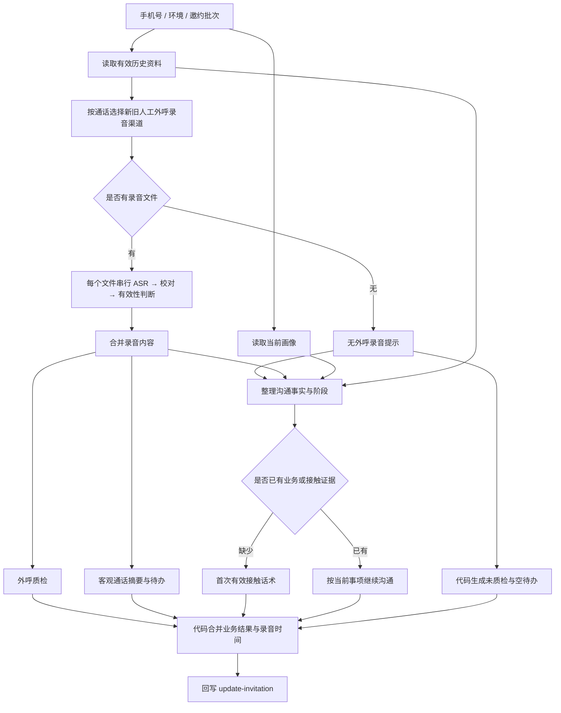
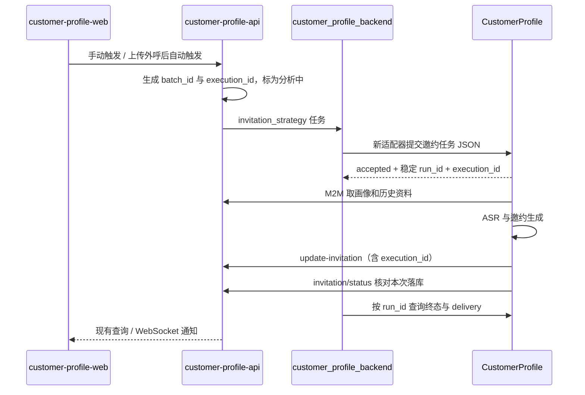

# 邀约工作流高代码迁移

基于 2026-10-29 提供的四份 Dify DSL，开发起点为 CustomerProfile `dev` 的 `8b8fc14`。
邀约工作流、接单与状态查询现维护于 `dev`，对应任务后端维护于 `main`。
自动化验证使用离线模拟服务；部署与真实业务质量验证须分别核对。

## 1. 四份文件的真实职责

原始文件含接口鉴权信息，不直接入库；文件与提示词的来源指纹见
[来源清单](../reference/invitation-workflow-sources.json)。运行期只依赖 Python 和已提取的模板，
不读取 Downloads，也不解释执行 YAML 中的代码。

| 文件 | 规模 | 职责 |
|---|---|---|
| 客户线索邀约 | 24 节点 / 30 边 | 主入口；读取画像、录音，生成质检、话术、待办，最后回写 |
| 外呼录音原始数据解析 | 19 节点 / 20 边 | 按环境读取有效历史资料，选择外呼渠道，逐个文件提取并合并 |
| 录音文件内容抽取（纯识别，无加工） | 12 节点 / 11 边 | ASR 提交、查询、识别结果提取、模型校对、有效性判断 |
| Gemini（异常输出重试版） | 11 节点 / 10 边 | 单次生成加最多两次异常重试，被主流程三处生成任务复用 |



### 主流程

入口接收 `phone_number / work_env / batch_id`。按环境并行读取完整画像与历史录音。
外呼录音读取 `OntologyManualOutboundCallRecordingFile`，兼容旧 `AIOutboundCallRecordingFile`。
优先匹配通话 ID，同一通话存在新渠道明细时，按记录顺序合并所有有效明细并去重 URL，
不再混入旧渠道可能累计多通电话的录音包。只有旧渠道时仍取对应的最新录音包。
仅完全没有批次或通话元数据的旧记录允许按最新记录降级；共享画像批次对应多通电话时拒绝猜测。
携带所选最新明细的 `updated_at`，选择节点另留存所有命中的记录 ID，供 trace 核对。
多个文件在 Dify 中是串行识别，`parallel_nums=10` 并未生效，因为 `is_parallel=false`。

ASR 子流程名称容易误导：它并非真正的纯识别。识别后还会调用模型校对，再调用模型判断
是否有效。无效时把正文替换为“该录音文件无有效内容”。此次迁移保留这两步，独立于
画像管线当前采用的零 LLM 纯识别变体，避免改变画像管线的既有行为。

有录音文件时，准备好转写后分三路：

1. 外呼质检：根据考核标准评价流程执行、沟通表达、专业知识、邀约引导。每维 0–100 分，
   细项固定为 3 / 3 / 2 / 3 项；总分为四维平均值四舍五入，等级按 90 / 80 / 70 / 60 分段。
   客户忙碌、要求微信、要求晚点联系属于有效短通话，不能机械按完整通话扣分。
2. 通话摘要与待办：只能从通话中抽取客观内容，不能从画像生成待办；无事项返回空数组。
3. 策略与话术：先整理由来源和时间标记的沟通资料，再按已有业务和接触证据选择首邀或后续沟通。
   客户在通话中明确表达的渠道、时间和拒绝意愿优先于画像推断。存在文件但被判无效时，
   仍保留后续沟通上下文，但不能补写客户原话。

没有录音文件时，质检与待办模型节点在 trace 中明确跳过，由代码生成“未质检”和空待办，
只调用话术模型。0 分用于兼容现有前端的“未检核”显示，不代表销售表现不合格。
取数失败、批次不匹配仍使任务失败，不得进入缺录音分支。此轮性能优化仅覆盖这一短路，
不启用转写缓存、不合并 ASR 子链调用、不调整并发。

### 个性化沟通

2026-10-30 用户授权按“整理事实、判断阶段、选择本轮唯一目标、生成话术”优化。
使用现有画像、历史业务记录和本次转写，不新增取数接口或模型调用。人工锁定、画像归纳、
引用依据、画像推进建议分别标记来源；高置信度和“已定稿”不等于客户亲口确认。
沟通资料作为独立节点留存，可通过现有 trace 查看。

没有外呼录音不再等同于首次接触：已有试驾、预约或方案沟通时，围绕当前未完成事项继续推进；
业务记录存在也不等于试驾已经完成，未知状态编码不能猜测。资料不足时先确认一个关键需求，
不为凑个性化补造客户事实。话术的业务依据写在现有 `strategy.reasoning`，不增加回写字段。

取消固定的一分钟开场、周末二选一、三段式微信与通用卖点配额。五步电话结构仍兼容前端，
允许每步简短，且在不宜电话时仅作为备用。已试驾客户可以以金融、置换或家人意见为本轮目标；
异地或暂缓客户可先确认联系安排，不强制推进立即到店。缺少门店时段、产品政策和执行凭据时，
只能询问时间意向或提出核实/发送动作，不宣称已预留时段、已发送资料或政策已经落实。
缺少接触证据却声称“上次您说”等错误会在原三次预算内反馈重试，原始输出和错误保留在 trace。
提示词与来源记录的修改已获本轮授权；原导出及上一版品牌修订哈希继续保留。

最后用代码合并结果，`recording_label` 使用录音记录时间，`generated_at` 使用结果生成时间。
回写体直接包含 `script / audit / follow_up_items / follow_up_summary`，没有画像回写使用的
`analysis_result` 外壳。工作流输出 `result` 是这份回写体的 JSON 字符串。

### 异常重试子流程

名称叫 Gemini，但本次导出实际使用 `qwen3.8-flash`。它检测 usage 全零、文本为空、
未闭合的 `<think>`、疑似只输出思考内容，最多调用三次；`output_json` 输入没有参与判断。
第三次输出直接返回，没有最终校验。因此原流程即使三次仍异常，也可能进入合并节点。

## 2. 实现选择与差异

复用 CustomerProfile 的持久化队列、worker、定义快照、子运行、请求尝试、限流、ASR 云适配
和运行台。业务逻辑为普通 Python 函数，工作流定义只表达依赖与留痕边界。没有再引入一套
任务框架，也不在运行期重放 Dify 节点图。

主要实现：

- `src/customer_profile/workflows/invitation.py`：取数、首邀/二邀分支、三路生成、合并、回写核对。
- `src/customer_profile/workflows/invitation_audio.py`：逐文件识别，保留此次导出的校对及有效性判断。
- `src/customer_profile/invitation_contract.py`：输入、话术、质检、待办的结构校验和确定性评分。
- `src/customer_profile/invitation_context.py`：沟通资料的来源与阶段整理，以及依赖上下文的对客事实校验。
- `src/customer_profile/invitation_inbound.py`：沿用接单进程的鉴权，持久化入队和按执行标识去重。

迁移基线保留七份提示词的原始文本与换行；2026-10-30 经用户确认，首邀和二邀统一为猛士。
来源清单保留原始哈希，运行期修订单独记录 `runtime_revision`。ASR 两份提示词仍用独立资源，
未修改既有画像模板。
没有逐节点复制重试子流程；它收敛到现有 `LlmClient`，仍是首次加两次重试，共用限流和留痕。

| 原导出的问题 | 当前实现的处理 |
|---|---|
| 主流程环境判断用相等，录音子流程用 contains，非标准输入可能取错环境 | 环境仅允许 `test / production`，取数、回写与凭据始终一起选择 |
| 任取第一条外呼资料，而接口按时间升序返回 | 优先匹配通话 ID，兼容画像批次；新渠道合并同一通话的明细，旧渠道取对应最新包 |
| 有批次资料却找不到目标批次 | 明确失败，避免拿别次通话生成本次邀约；仅无批次元数据的旧记录降级选最新 |
| `media_urls=[]` 被序列化为非空文本，可能错误进入多文件支路 | 单 URL、JSON 数组、空数组统一处理；多文件保持原顺序，去重同一 URL |
| 历史资料解析失败被当作没有录音 | 取数或形状错误使运行失败，不生成“无数据”的成功结果 |
| 无录音也调用质检和待办模型 | 明确跳过两次调用，代码生成未质检和空待办，话术模型独立执行 |
| 无录音被当作首邀，画像标签被当作客户原话 | 按接触和业务证据路由，标记事实来源，按本轮目标生成话术并校验虚构既往沟通 |
| JSON 错误被合并节点吞成空字典，再成功回写 | 启用结构化输出；JSON 与业务形状在三次尝试预算内校验，带具体错误纠正重试，失败阻断回写；不抢救截断 JSON |
| 模型自己算分或给错等级 | Python 根据四维有效整数分数计算总分与等级，采用普通四舍五入 |
| 缺失录音时间时填当前时间 | 保留未知，不虚构上传时间；有时区的时间转为上海时间展示 |
| 没有 execution_id | 新接单接口必填，原样透传至成功回写；内部 `/runs` 保留旧系统无 token 的兼容路径 |
| 接单重试可能重复生成、把在飞运行重新入队 | 手机号、批次、execution_id 生成稳定 run_id；数据库首次插入，重复返回同一次运行 |
| HTTP 200 不等于本次邀约已被写入 | 回写后读业务状态，核对手机号、批次、execution_id、完成状态、话术和质检是否均存在 |
| 回写超时后盲目重发可能重复归档 | 回写只尝试一次；超时、状态不匹配交给任务后端核对，不自动整条重跑 |

当前模型通过 `LLM_BASE_URL / LLM_API_KEY / LLM_MODEL` 接入兼容服务，temperature 沿用本仓库
统一的 0.5。原导出主生成是 1、录音校对/有效性判断是 0.4，因此迁移后的输出不应宣称与
Dify 逐字等价；相同样本的业务质量对照仍需真实模型验证。

邀约话术、质检、待办和录音有效性判断共用 Pydantic 契约生成请求 Schema，并继续在本地
校验业务规则。当前 DeepSeek 使用 JSON Object；切换 `LLM_MODEL` 为 `qwen3.8-flash` 或其
快照版时自动使用 strict JSON Schema，不增加 env 开关。依据为百炼的
[结构化输出说明](https://help.aliyun.com/zh/model-studio/qwen-structured-output)和
[DeepSeek 能力说明](https://help.aliyun.com/zh/model-studio/deepseek-api)。同名模型经代理接入时，
若代理明确以 400/422 拒绝 `json_schema`，在原三次预算内退回 JSON Object，仍保留失败尝试。
其他尚未确认 Schema 能力的模型使用 JSON Object；不将其等同于保证所有兼容供应商都支持。
普通文本、画像 JSONL、数组输出不启用此对象约束。解析或业务校验失败后，下一次请求携带
最近一次输出与具体字段错误，重新生成完整结果；原始响应、每次请求和错误均保留在 trace 中。
以上约束不保证事实正确，仍须对真实话术质量进行验收。

部署侧通过仓库根目录 `.env` 配置模型，环境变量优先于文件。ASR 模型、版本、识别开关
及 LLM/ASR 接口路径均有配置入口，完整示例以 `.env.example` 为准。旧配置不补新字段时
沿用原适配器默认值；修改 ASR 识别参数后不会命中旧参数的转写缓存。变更后需重启相关进程。
这些配置只覆盖现有 OpenAI 兼容文本协议和火山 AUC 协议；更换响应结构或鉴权协议仍需适配器。

### 提示词业务口径与待确认事项

原导出首邀模板指定广汽埃安及约 10–15 万元市场，二邀使用泛汽车身份。2026-10-30 用户确认
统一使用猛士，已同步修订首邀、二邀的角色、示例及品牌约束，并移除固定价位及排除越野场景的限制。
具体车型、价格、配置和权益只取实际输入；客户原有预算、竞品关注和通话事实仍须保留。
有效性判断提示词的 JSON 示例还包含大写 `True`、注释和双大括号，实际并非合法 JSON；本轮
通过输出校验拦截，示例文本修订应作为单独的提示词变更。

## 3. 与现有仓库的适配

任务后端适配已在 `customer_profile_backend` 的 `main` 分支实现，
首次接入提交为 `e1197a0`，复用已有的执行标识、统一 Worker 与 008 表结构。部署时应同时核对
本服务和任务后端的实际镜像提交；本地离线联调通过不代表线上已经升级。



| 仓库 | 现状及本轮适配边界 |
|---|---|
| CustomerProfile | 本轮新增邀约能力，已有画像入口继续工作；工作流统一注册，运行台可查看子运行与请求尝试 |
| customer-profile-api | 已有完整邀约存储、历史归档、成功/失败回调、执行身份校验和状态核对接口；沿用它作为业务数据唯一来源 |
| customer_profile_backend | 负责业务队列、领取、恢复及失败通知；优化分支已新增独立的 invitation_runner 适配器和可选 Worker 组 |
| customer-profile-web | `InvitationTab.jsx` 与 `invitationApi.js` 消费现有 script/audit/待办结构；成功结果保持该契约，无需改展示页面 |
| customer-profile-backend-runner | 环境中声明过此路径，但本地目录不存在；本轮未据此假设已有可用适配器 |

### 任务后端适配与切换

后端使用 `WORKFLOW_PLATFORM=invitation_runner` 的专用 Worker，只消费 `invitation_strategy`。
画像 `runner` 继续使用 `/runs`，邀约适配器使用本服务的鉴权入站协议。Compose 新组默认
不开启，通过 `invitation-runner` profile 选择；后端启用步骤以其 `docs/native-invitation-runner.md`
和 `docs/worker-configuration.md` 为准。

1. 将 `customer_phonenumber` 映射成 `phone_number`，透传 `batch_id / work_env / execution_id`。
   API、领域记录、数据库、提交回执、原生调用及失败通知全程保留执行标识；新目标跳过没有
   标识的历史邀约，不猜测或批量回填历史身份。
2. 通过 `X-API-Key` 调本服务新的邀约接单接口，把返回的 `run_id` 持久化为远程运行标识。
   提交响应丢失时按稳定 ID 做一次鉴权读取；无法证明入队则保留未知语义，不盲目再 POST。
3. worker 恢复后继续查同一 run_id，不重新触发完整生成。重跑一项已经终结的业务任务时由
   业务 API 创建新的 execution_id，同一录音批次可以对应多次不同的执行。
4. 同时检查执行状态与 `delivery`：`confirmed` 才表示业务结果已核对落库；`skipped` 为影子
   运行；`unknown` 表示回写可能发生，需要向业务 API 查同一执行；`not_attempted` 表示本次
   尚未尝试成功回写。不能只看到运行成功或 callback HTTP 200 就将业务队列标成功。
5. 原生服务的 `failed + delivery=not_attempted` 已完成内部模型重试，后端不再重复提交同一个
   不可变终态；复用 outbox 调用 `invitation-failed`，携带同一个 execution_id 与 `final=true`。
   `unknown`、中断或身份不匹配进入核对状态，不发送可能覆盖已落库成功的失败通知。

**后端接入代码已完成，线上路由尚未切换。** 两个仓库的真实路由、SQLite 队列与 worker
已通过离线契约联调；模型、ASR 和业务 API 使用模拟响应。实际部署及真实业务验收仍需执行。

## 4. 接单与验证

邀约接口复用 `customer_profile.inbound`（默认 8099），沿用独立的 `INBOUND_API_KEY`；
接单进程只写队列，执行由邀约专用 worker 负责。生产画像保持既有 `POST /runs` 地址；
`POST /api/v1/tasks` 保留在 `WORKFLOW_SCOPE=all` 的兼容模式，邀约专用进程不再接画像。

新邀约请求为 JSON，示例只使用测试数据，密钥通过调用端配置注入：

```http
POST /api/v1/invitation-tasks
X-API-Key: <INBOUND_API_KEY>
Content-Type: application/json

{"phone_number":"13800000000","batch_id":"call-001","execution_id":"execution-001","work_env":"test"}
```

手机号、非空批次和执行标识必填，环境默认 `test`。接收后返回 200、`accepted`、稳定 run_id
与原始业务身份。重复请求返回原运行，包含已失败或已完成的运行；同一执行身份改变环境返回
409。非法输入 422，队列满 429，缺少/错误密钥 401/403，未配置密钥 503。

`GET /api/v1/invitation-tasks/{run_id}` 使用同一密钥，返回执行状态、业务身份、`delivery`、
结果和错误。结果中的 `outputs.result` 仍是回写体 JSON 字符串。查询不暴露其他类型的运行。
详细字段约束以 Pydantic 模型与入站 OpenAPI 为准。

运行服务沿用现有部署方式；首次验证保持 `WRITEBACK_ENABLED=false`。测试环境取数与回写使用
`PROFILE_API_BASE_URL / PROFILE_API_KEY`，生产使用 `MHERO_BASE_URL / PROFILE_MHERO_API_KEY`。
录音仍走本仓库已接入的火山 AUC，不依赖导出中已过时的内网 ASR 地址。执行层现已拆成
画像与邀约两组 API/worker，业务并发和等待派发队列仅由 backend/MySQL 负责。执行进程
自动启动已派发任务，保留出网和模型限流；Compose 自动构建镜像。历史库继续共用，领取、容量及启动
恢复按主任务归属过滤；更新一组不会恢复或中断另一组。具体迁移与独立发布见部署运行指南。

离线验证命令：

```bash
PYTHONPATH=src .venv/bin/python -m pytest tests/test_invitation.py tests/test_invitation_inbound.py
```

测试用本地 MockTransport 模拟业务 API、云 ASR 和模型，覆盖无/单/多文件、首邀/二邀、无效
录音、环境与凭据选择、结构错误重试与耗尽阻断、回写超时不重发、过期回写核对、鉴权、并发
重复提交和终态去重。模板测试检查来源哈希或已获确认的运行修订哈希，不依赖原始 Downloads 文件。

2026-10-29 本地验证结果：新增邀约测试 **48 项全部通过**；全仓回归 **1124 项通过、74 项跳过**。
四份来源文件指纹、七份提示词逐字节一致性及中文 UTF-8 检查通过；原导出中的凭据未进入新增文件。

后续仍需部署对应版本，并使用脱敏真实录音与相同画像
进行 Dify/高代码影子对照，重点检查短通话评分、拒绝联系、渠道偏好与客观待办；随后小流量
启用回写并核对执行标识。离线模拟通过不代表真实识别效果、模型质量或线上接口已经验收。
