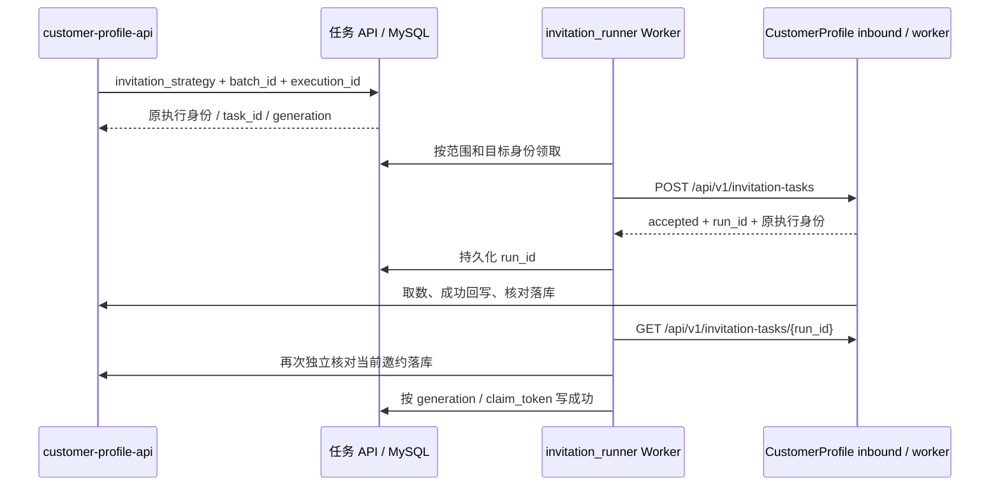

# CustomerProfile 高代码邀约服务接入

本次基于 `codex/unified-workflow-workers` 的 `b5f890e`，复用该分支已有的统一 Worker、
`execution_id`、失败通知 outbox 和业务回写核对。新增适配器 `invitation_runner`，
对应 CustomerProfile 的 `codex/invitation-workflow`（`c3e5c3e`）。未修改生产配置或切换流量。

## 分工与契约



画像适配器 `runner` 继续使用执行服务的 `/runs` 协议。邀约使用 8099 入站进程提供的
独立鉴权协议，不能把两个适配器的 URL、请求体或结果解析器互换。新适配器只消费
`invitation_strategy`，使用 `X-API-Key`，该值对应原生服务的 `INBOUND_API_KEY`。

业务任务 API 的 multipart 提交和返回结构不变。该分支已在 API、领域记录、008 数据列、
入队回执、成功验证和最终失败通知中保留执行标识；本次补齐原生服务的提交及轮询上下文。
`customer_phonenumber` 映射为原生入参 `phone_number`，`batch_id / execution_id / work_env`
原样透传。手机号和批次必须符合原生服务约束；新 Worker 的领取 SQL 会跳过无执行标识的
历史邀约，不猜测或批量回填执行标识。历史任务继续由原目标处理，或从业务 API 重新触发。

原生 `run_id` 为手机号、批次、执行标识的稳定摘要，共 68 字符；不得套用画像 Runner 的
64 字符校验。提交回执、运行详情和最终结果都核对完整身份。结果为完整邀约对象，保留
`script / audit / follow_up_items / follow_up_summary`，不使用画像的 `analysis_result` 包装。

## 运行与失败语义

- 获得远端运行标识后先落库，再轮询。重启、查询超时或业务核对接口暂时不可用时恢复原运行；
  保持相同目标 ID、revision、URL 和凭据，不改投另一工作流。
- 提交响应丢失或 5xx 时，利用稳定 ID 做一次鉴权读取；身份一致才确认入队。仍无法确认时
  标记 `SUBMIT_UNKNOWN`，不盲目再 POST，也不通知业务“最终失败”。
- 明确的 429、尚未建立连接的超时可由既有后端重试策略处理，遵守 Retry-After 和同目标限制。
- 原生运行只有 `succeeded + delivery=confirmed` 才进入独立的业务状态核对；必须再次确认同一
  手机号、批次、执行标识，以及话术和质检均已落库，之后才把队列任务写成成功。
- `delivery=skipped` 是影子生成，不能把正式业务任务标成功。`unknown`、中断、执行身份
  不匹配、结果格式无法核实都标为 `REQUIRES_RECONCILIATION`，不触发最终失败回调。
- `failed + delivery=not_attempted` 表示原生服务已明确失败且尚未尝试回写；服务内部已完成
  三次模型尝试。后端直接结束该次执行，复用 outbox 通知业务失败。重复 POST 同一执行会
  返回原终态，因此不再把它计作“新工作流”重跑。重新生成须由业务 API 产生新的 execution_id。

新适配器保留通用 Worker 的目标绑定、租约与 generation/claim_token 原子更新，不改变
擎天、Dify 或画像 Runner 已有的终态重试方式。新功能不新增迁移，复用已有 001–008。

## 配置与启用

统一的容量、恢复和配置优先级以[Worker 配置指南](worker-configuration.md)为准。
`.env.example` 增加了占位配置，Compose 新组默认不启动，需选择 `invitation-runner` profile。

| 配置 | 作用 |
|---|---|
| `INVITATION_RUNNER_BASE_URL_TEST / _PRODUCTION` | 原生邀约接单服务根地址，例如测试环境 `http://host.docker.internal:8099` |
| `INVITATION_RUNNER_API_KEY_TEST / _PRODUCTION` | 对应环境的原生入站密钥；无环境间回退 |
| `INVITATION_RUNNER_WORK_ENVS` | 默认 test；生产必须显式配置 URL、Key 和环境 |
| `INVITATION_RUNNER_TARGET_ID / _REVISION` | 新目标身份，不能复用画像 Runner 或旧邀约擎天的身份 |
| `INVITATION_RUNNER_CONCURRENCY / _TARGET_MODE` | 映射到统一 Worker 的每进程并发与 active/draining 模式 |
| `INVITATION_RUNNER_REQUEST_TIMEOUT_MS / _POLL_INTERVAL_MS / _POLL_TIMEOUT_MS` | 请求超时、查询间隔和每轮查询时限；默认 15000 / 2000 / 2400000 |

`PROFILE_FAILURE_CALLBACK_ENABLED=true` 以及业务 `PROFILE_API_BASE_URL / PROFILE_API_KEY`
仍用于业务核对及最终失败通知，不能用原生入站密钥替代。业务环境有不同地址时，按现有
契约配置 `PROFILE_API_BASE_URL_TEST / _PRODUCTION` 及对应 Key；所有共享 outbox 的 Worker
应保持业务回调配置一致，不能因新增测试组而把生产失败通知送到测试 API。

首先启动 CustomerProfile 的 inbound 与 worker，配置模型、ASR 和业务 M2M 端点。
正式任务需要原生服务开启 `WRITEBACK_ENABLED=true`。仅做影子质量比较时，使用原生服务
的独立测试任务入口，不让正式业务队列等待一份不会回写的结果。

保存配置后，仅检查渲染合法性，不输出展开后的密钥：

```bash
scripts/compose.sh --profile invitation-runner config -q
```

已完成 008 升级的环境只重建 API/Worker，不重新运行迁移，也不改生产数据库：

```bash
scripts/compose.sh --profile invitation-runner up -d --build --no-deps api invitation-runner-worker
```

同目标副本共享相同 ID、revision、URL 和密钥：

```bash
scripts/compose.sh --profile invitation-runner up -d --no-deps --scale invitation-runner-worker=2 invitation-runner-worker
```

默认擎天组仍声明消费邀约，因此启用新组并不代表全部邀约自动切换。先在测试环境验证；
准备全量切换时停止旧目标接新邀约并保留其在途恢复能力，新目标开始消费未绑定任务。
在途运行及其失败通知排空之前，保留旧目标原凭据与 ID/revision。具体模式迁移见配置指南，
不要把旧邀约目标直接改为原生 URL 却保留相同目标身份。

如果邀约全量切向原生服务，可让 active 擎天组只声明 `customer_profile`；如仍有旧目标邀约
在途任务，用原平台/原身份的 draining 组排空。业务 API 必须启用 execution_id；原生组不会
领取没有标识的旧任务。回滚时让原生组 draining，保留在途恢复，再恢复原邀约目标的新任务
范围；无需撤销本次数据库迁移，因为本次没有新增迁移。

## 验证

```bash
pytest tests/unit -q
customer-profile-check-contracts
```

另提供跨仓库离线契约测试，使用真实 CustomerProfile 入站路由、SQLite 队列和 worker，
上游模型、ASR、业务 API 全由 MockTransport 模拟。使用安装了 CustomerProfile 开发依赖的
Python，并显式选择该源码目录；不读取部署配置，也不连接 MySQL 或真实业务接口：

```bash
RUN_NATIVE_INVITATION_CONTRACT=1 \
CUSTOMERPROFILE_SOURCE_ROOT=/absolute/path/to/CustomerProfile \
/absolute/path/to/CustomerProfile/.venv/bin/python -m pytest tests/integration/test_native_invitation_contract.py -q
```

真实 MySQL 的身份筛选用例随现有 `worker_mysql_integration` 测试提供，仍仅允许显式指定的
本地隔离测试实例。本次没有启动 Docker、运行真实模型、迁移业务数据库或调整线上配置。

2026-10-29 验证：单元测试 **395 项通过**（修改前基线 322 项）；真实原生路由的跨仓库
离线契约测试 **2 项通过**，覆盖无录音首邀和两份录音二邀。OpenAPI、输出和迁移契约检查通过；
Compose 的默认组和可选组渲染均通过。真实 MySQL 用例因本机 Docker daemon 未运行而未执行，
不以离线 SQL 筛选测试替代数据库锁与并发验收。
